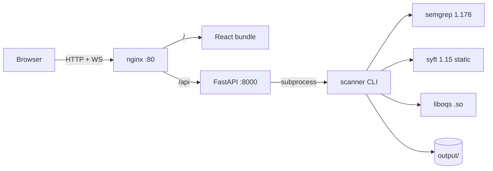

# ECDAT

**Enterprise Cryptographic Discovery & Analysis Tool**

Scan a codebase for cryptographic usage, score the quantum risk, and get a
post-quantum migration plan with measured before/after numbers.

Single folder. Single command. Zero external dependencies at runtime.

---

## Quick start

```bash
cd ecdat-project
cp .env.example .env          # optional, defaults are sane
make setup                    # fetch binaries, build liboqs, build the image
make up                       # UI on :8080, API on :8000
```

Open **http://localhost:8080**, paste a Git URL or path, hit Scan.

Scan from the shell instead:

```bash
make scan SCAN_TARGET=/path/to/repo
# or straight through the API
curl -X POST localhost:8000/api/scan \
  -H 'content-type: application/json' \
  -d '{"target":"https://github.com/org/repo"}'
```

Results land in `./output/<scan_id>/cbom.json` (CycloneDX 1.6) and
`./output/<scan_id>/report.json`.

---

## What it does

1. **Ingest** — Git URL, local path, zip, or container image, into an isolated
   `/tmp/scan_<uuid>` workspace.
2. **Detect** — 46 Semgrep rules across Java, Python, JS/TS, Go, C/C++, PHP and
   C#, plus cross-language regex rules for PEM keys, weak primitives and
   config-file crypto settings. Syft contributes a dependency SBOM.
3. **Enrich** — deterministic heuristics classify each finding as
   algorithm / usage / key management / risk. Every decision records which
   rule fired, in `extra.enrichment_rule`.
4. **Score** — Mosca inequality `Risk = (X + Y) > Z` blended with a quantum
   effort estimate.
5. **Recommend** — map each primitive to its NIST-standardised PQC
   replacement, with rationale and an estimated blast radius.
6. **Benchmark** — measure the actual before/after delta using the locally
   built liboqs (ML-KEM-768, ML-DSA-65) against a classical baseline.
7. **Emit** — a CycloneDX 1.6 CBOM where each primitive is a
   `cryptographic-asset` with full `cryptoProperties`.

---

## Architecture



One image, two roles:

```bash
make up                                   # UI :8080, API :8000
docker run --rm -v "$PWD/output:/app/output" ecdat:latest scan <target>
```

### Dashboard

| Tab | What it does |
|---|---|
| **Explorer** | Every finding in a sortable, filterable grid. Click a row for the full snippet, the Mosca arithmetic, the quantum-effort citation, and why the heuristic classified it. |
| **Heatmap** | Algorithm family × severity. Cells are sqrt-scaled so one outlier does not flatten the grid. **Click a cell to drill into the Explorer** filtered to that family and severity. |
| **Mosca** | Drag Z (5–30y) and the whole set re-ranks server-side, debounced. Bar chart of the top 12. |
| **Benchmarks** | Before/after table per migration pair, colour-coded better/worse, plus the migration plan with per-primitive rationale. |
| **Progress** | Live WebSocket log with stage badges, and the raw CycloneDX document. |

Ports are configurable: `make up UI_PORT=9000 API_PORT=9001`.

---

## Commands

| Command | Effect |
|---|---|
| `make setup` | fetch syft, build liboqs, build liboqs-python wheel, build image |
| `make build` | build the image only |
| `make up` / `make down` | start / stop |
| `make scan SCAN_TARGET=...` | one-shot scan |
| `make rerisk ID=... Z=10` | re-rank a finished scan at a different Mosca Z |
| `make health` | semgrep / syft / liboqs / rules status |
| `make verify` | check every required artifact exists |
| `make clean` / `make distclean` | remove results / remove everything |

---

## API

| Method | Path | Purpose |
|---|---|---|
| `POST` | `/api/scan` | start a scan, returns `scan_id` |
| `GET` | `/api/scan` | list scans |
| `GET` | `/api/scan/{id}/status` | poll state (WebSocket fallback) |
| `WS` | `/api/scan/{id}/ws` | live progress stream |
| `GET` | `/api/cbom/{id}` | CycloneDX document + rollup |
| `GET` | `/api/risk/{id}` | ranked findings |
| `POST` | `/api/risk/recalculate/{id}?z=10` | re-rank at a new Mosca Z |
| `GET` | `/api/benchmark/{id}` | before/after numbers |
| `GET` | `/api/recommendations/{id}` | migration plan |
| `GET` | `/health` | component health |

CORS is intentionally disabled — the UI is same-origin behind nginx.

---

## Risk model

**Mosca** (Mosca, B. *"When will we regret this cryptography?"*, IEEE S&P 2019)

```
Risk = (X + Y) > Z
```

- `X` — shelf-life of the protected data, inferred from path/context keywords
  (`payment`→10y, `pii`→7y, `auth`→5y, default 3y)
- `Y` — migration cost, from algorithm family × blast radius
- `Z` — collapse time, user-controlled (default 15y). Drag it in the UI and the
  ranking re-sorts: families used in many places rise fastest.

**Quantum effort** — the serial Toffoli count needed to break a primitive on a
fault-tolerant machine, from published resource estimates:

| Primitive | Toffoli | Logical qubits | Source |
|---|---|---|---|
| RSA-2048 | 1.0 × 10¹² | 4099 | Gidney & Ekerå 2019 |
| ECDSA P-256 | 6.6 × 10¹⁰ | 2330 | Gidney 2019 |
| AES-128 | 1.8 × 10¹⁹ | 2985 | Grover |
| AES-256 | 3.0 × 10³⁸ | ~20000 | Grover (extrapolated) |

Normalised 0–10 on a log₂ scale, then blended `0.6 × Mosca + 0.4 × quantum`.

**Classical weakness — a third term, added deliberately.**

The plan's composite scores MD5 at **0.0**. It carries no migration pressure
under Mosca (short data shelf-life, trivial swap) and no quantum exposure
(trivial classical break), so both terms are zero — while the enrichment layer
correctly labels it `critical`. A finding labelled critical that ranks last is
worse than no score at all: it gets buried.

The plan's composite is therefore preserved exactly as `migration_urgency`, and
the final score takes the max against classical breakage:

```
final = max(0.6*mosca + 0.4*quantum,  classical_weakness * 10)
```

`classical_weakness` is 1.0 for primitives already broken on today's hardware
(MD5, RC4, DES, 3DES, SSLv2/v3, TLS 1.0/1.1), 0.5 for deprecated (SHA-1),
0.9 for asymmetric keys under 2048 bits. Taking the max rather than adding a
third weight keeps the plan's 0.6/0.4 intact for everything else while giving
dead crypto a floor it cannot be outranked from.

Both terms are reported separately on every finding, so the arithmetic is
auditable — see `extra.risk` in `report.json`.

> **Why quantum effort is a table and not a VQE.** The original design ran a
> variational quantum eigensolver on Qiskit Aer to "estimate quantum effort". A
> VQE circuit is something *you* author — its cost comes from the ansatz you
> chose, not from the difficulty of attacking RSA. The underlying figures are
> published resource estimates, not simulation outputs. Running a variational
> circuit to rediscover a hardcoded constant would make the score look
> empirically derived when it is not, and would add ~1 GB of Qiskit to the image
> for no information. Qiskit is therefore not a dependency.

---

## Measured results

From the in-image benchmark suite (this host, 20 iterations):

| Scheme | Keygen | Sign/Encaps | Verify/Decaps | Pub key | Ciphertext/Sig |
|---|---|---|---|---|---|
| RSA-2048 | 49.45 ms | 0.029 ms | 0.622 ms | 294 B | 256 B |
| ECDSA P-256 | 0.029 ms | 0.030 ms | 0.086 ms | 65 B | 70 B |
| AES-256-GCM | 0.001 ms | 0.002 ms | 0.004 ms | 32 B | 39 B |
| ChaCha20-Poly1305 | 0.001 ms | 0.002 ms | 0.004 ms | 32 B | 39 B |
| **ML-KEM-768** | **0.017 ms** | 0.017 ms | 0.021 ms | **1184 B** | **1088 B** |
| **ML-DSA-65** | 0.049 ms | 0.120 ms | 0.046 ms | **1952 B** | **3309 B** |
| **ML-DSA-87** | 0.074 ms | 0.107 ms | 0.071 ms | **2592 B** | **4627 B** |

The headline trade-off, measured rather than asserted: **ML-KEM-768 keygen is
~2900× faster than RSA-2048** (0.017 ms vs 49.45 ms), at the cost of **4× larger
keys and 4.25× larger ciphertexts**. That is the actual migration decision, and
it is exactly the kind of thing a report should show instead of a claim.

---

## Layout

```
ecdat-project/
├── Dockerfile              multi-stage: builder -> ui-builder -> runtime
├── docker-compose.yml
├── Makefile
├── .env.example
├── bin/
│   ├── syft                static binary
│   ├── wheels/             liboqs-python (pure python)
│   └── liboqs/             liboqs.so + headers  <- built by make setup
├── scanner/
│   ├── requirements.txt
│   ├── rules/crypto-detection.yaml
│   ├── src/
│   │   ├── __main__.py     CLI: scan / rerisk
│   │   ├── ingestion.py    git | path | zip | image -> workspace + SBOM
│   │   ├── target_guard.py refuse non-public hosts + paths outside the root
│   │   ├── detection.py    semgrep runner + syft parser -> Finding
│   │   ├── enrichment.py   heuristic classify (no LLM)
│   │   ├── cbom_builder.py CycloneDX 1.6 assembly
│   │   ├── risk_engine.py  Mosca + quantum table
│   │   ├── recommender.py  PQC mapping + liboqs benchmark
│   │   └── utils.py        logging, config, progress events
│   └── tests/
│       ├── test_scanner.py       unit, no docker needed
│       ├── test_target_guard.py  unit, SSRF + path-escape policy
│       ├── test_api_auth.py      unit, skipped unless API deps present
│       ├── test_integration.py   end-to-end, runs in the image
│       └── fixtures/insecure-app deliberately broken sample
├── api/
│   ├── requirements.txt
│   └── src/{main,routes,models,worker,security}.py
├── docker/{entrypoint.sh,nginx.conf}
├── deploy/tunnel.sh      cloudflared wrapper; refuses an unauthenticated start
├── docs/DEPLOYMENT.md    exposure policy, threat table, known gaps
├── ui/                     React + Vite dashboard
│   ├── src/
│   │   ├── App.tsx         layout: sidebar + tabbed main panel
│   │   ├── types.ts        hand-written mirror of api/src/models.py
│   │   ├── services/api.ts axios client
│   │   ├── hooks/
│   │   │   ├── useStore.ts     zustand store
│   │   │   └── useScan.ts      WebSocket + health polling
│   │   └── components/
│   │       ├── CBOMTree.tsx        tanstack-table grid + detail pane
│   │       ├── RiskHeatmap.tsx     family x severity grid, click to drill down
│   │       ├── MoscaSlider.tsx     Z slider + re-ranking chart
│   │       ├── BenchmarkCard.tsx   before/after deltas + migration plan
│   │       └── ScanProgress.tsx    WebSocket log + stage badges
│   └── index.css           plain CSS, no Tailwind
└── output/                 generated CBOMs + reports
```

---

## Extending the rules

Edit `scanner/rules/crypto-detection.yaml`, then:

```bash
docker run --rm -v "$PWD/scanner/rules:/app/scanner/rules:ro" \
  ecdat:latest semgrep scan --validate --config /app/scanner/rules
make build && make scan SCAN_TARGET=/your/repo
```

Every rule carries `metadata.cwe`, `cwe2`, `severity`, `algorithm`, `family`
and `mode`. Cross-cutting string matching uses `languages: [generic]` with
`pattern-regex` plus `paths.include` filters, so config rules do not re-scan
every source file.

---

## Testing

```bash
# unit (no docker)
cd scanner && python -m pytest tests/test_scanner.py -v

# end-to-end, in the image
docker run --rm -v "$PWD:/w" -w /w \
  --entrypoint /venv/bin/python ecdat:latest \
  -m pytest scanner/tests/test_integration.py -v
```

The integration suite scans a deliberately broken fixture and asserts each
planted weakness is caught — AES/ECB, DES, MD5, an inline PEM private key, a
hardcoded JWT secret, 1024-bit RSA, TLS 1.1 config, and keystore settings —
plus that the SBOM picks up jjwt and BouncyCastle.

> The original acceptance criterion targeted `spring-petclinic` expecting it to
> contain JWT signing and jjwt/bouncycastle. It does not: that repository has no
> crypto code and its `pom.xml` declares no JWT or BouncyCastle dependency. The
> test would have been vacuous. The fixture replaces it.

---

## Offline / air-gapped

`make setup` needs the network. After that, `make up` and `make scan` do not:
semgrep, syft and liboqs are all baked into the image, and enrichment is local
heuristics. To verify:

```bash
docker run --rm --network none -v "$PWD/output:/app/output" \
  ecdat:latest scan /w/scanner/tests/fixtures/insecure-app
```

Scan a **local path or zip** when disconnected — ingesting a Git URL obviously
requires network.

---

## Exposing it beyond localhost

**Read [`docs/DEPLOYMENT.md`](docs/DEPLOYMENT.md) before putting this on a
public URL.**

ECDAT is safe to run on `localhost` and unsafe to run on the open internet with
its defaults, because `POST /api/scan` takes an arbitrary target: a local path
is copied and scanned, and the CBOM response contains source snippets, so an
unauthenticated caller can read files off the host. A Git URL target is cloned
by the server, which is an SSRF primitive against anything the host can reach.

Three settings change that, all off by default so the local quickstart keeps
working:

```bash
export ECDAT_API_KEY="$(openssl rand -base64 32)"   # required when exposed
export ECDAT_SCAN_ROOT="$PWD/demo-targets"          # confine local targets
export ECDAT_MAX_CONCURRENT_SCANS=2                 # bound CPU per caller
```

The target policy lives in `scanner/src/target_guard.py` and is enforced in the
scanner itself, so the CLI and the API share one implementation. The API key
gate is a router dependency in `api/src/routes.py`; the WebSocket takes the key
as `?key=` because browsers cannot set headers on a handshake.

```bash
./deploy/tunnel.sh quick    # throwaway trycloudflare.com URL
```

Put **Cloudflare Access** in front of anything you intend to keep — it is a
better control than anything in this repository, because an unauthenticated
request never reaches the scanner.

---

## Requirements

- x86_64 Linux (aarch64 supported by the Makefile; the syft URL is pinned to
  linux_amd64 and needs editing for arm64)
- Docker with Compose v2
- ~4 GB disk for the image, ~2 GB RAM
- No GPU. The LLM phase was cut and the only optional accelerator went with it.

---

## Troubleshooting

**`import oqs` tries to `git clone`** — the wheel could not find `liboqs.so` and
fell back to building it. Check `OQS_INSTALL_PATH` points at a directory holding
`lib/liboqs.so*`, and that the lib has no unmet deps:
`ldd /opt/oqs/lib/liboqs.so | grep "not found"`. If you see
`version 'OPENSSL_3.3.0' not found`, the lib was built with
`OQS_USE_OPENSSL=ON` on a newer-OpenSSL host; `make setup` rebuilds with
`OQS_USE_OPENSSL=OFF` so the artifact is self-contained.

**`No such file or directory: git`** — the runtime image needs git for Git URL
ingestion. It is installed; rebuild if you used an older Dockerfile.

**semgrep rule errors** — validate before scanning:
`semgrep scan --validate --config scanner/rules/`. `generic` cannot be mixed
with other languages in one rule's `languages:` list; use `generic` + `paths`.

**semgrep scans 0 files** — semgrep adopts the nearest enclosing git repo as its
project root, so a path inside a repo you have not committed yields nothing.
Ingestion copies the target to `/tmp` first, so this only bites on direct
`semgrep` invocations.

**Snippets read `requires login`** — that is semgrep 1.178's `extra.lines`
placeholder, not real source. ECDAT reads snippets off disk instead, so you
only meet it when inspecting raw semgrep JSON yourself.

**Scan finds nothing** — semgrep needs the language to match the file. A `.h`
file will not be picked up by the `c` rules. Add the language or a
`generic`/`pattern-regex` rule.

**Scans are slow** — semgrep dominates. Narrow the target, or lower
`--max-target-bytes` in `detection.py`. Pass `--no-bench` to skip benchmarks.

**Compose commands fail** — the Makefile falls back to plain `docker run` when
no Compose plugin is present, so `make up` works either way.
`docker-compose.yml` is there for users who prefer it.

---

## Deviations from the original plan

Recorded so they are not mistaken for oversights:

| Plan | What shipped | Why |
|---|---|---|
| Ollama + 4.36 GB Qwen GGUF, LLM enrichment | Dropped; heuristic enrichment | The download failed twice, leaving 1.10 GB of 4.36 GB. The GPU is a 4 GB RTX 3050 Mobile, which could not hold a 4.36 GB q4 model regardless. Heuristics are deterministic and record which rule fired. |
| Qiskit Aer VQE for "quantum effort" | Cited lookup table | A VQE circuit you author does not measure the cost of attacking RSA; the figures are published resource estimates. Drops ~1 GB of dependencies. See *Risk model*. |
| `0.6·Mosca + 0.4·VQE` | Same, plus a classical-breakage floor | As written it scores MD5 at 0.0. See *Risk model*. |
| `pip install --no-index` | PyPI allowed at build time | `/wheels` holds exactly one liboqs wheel; everything else is from PyPI. "Zero external dependencies" is a runtime guarantee, not a build-time one. |
| `./bin/semgrep` static binary | `semgrep` from PyPI | Modern semgrep GitHub releases publish zero binary assets, so the static download yields 0.107.0 — which cannot express the rule syntax in `scanner/rules/`. |
| Test target `spring-petclinic`, expecting JWT + jjwt/bouncycastle | `tests/fixtures/insecure-app` | petclinic contains no crypto code and declares no JWT or BouncyCastle dependency; its SBOM was 37 Spring/GitHub-Actions artifacts. The original criterion would have passed vacuously. |
| Air-gap test that disconnects the network, then scans a Git URL | Air-gap test scans a local path | Cloning requires network. "Offline" means no external *analysis* calls. |
| `oqs-*.whl` expected in `bin/wheels/` | Only `liboqs_python-*.whl` | No such artifact exists. `oqs` is the import name provided *by* liboqs-python. |
